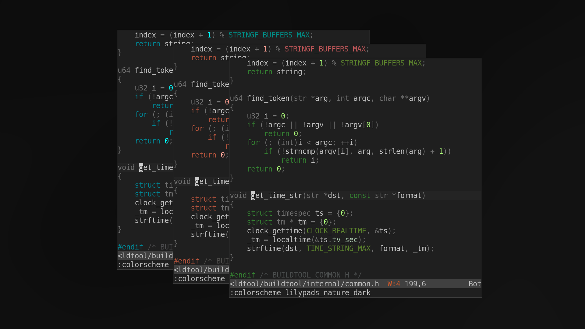
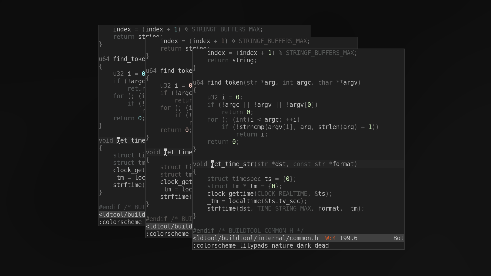
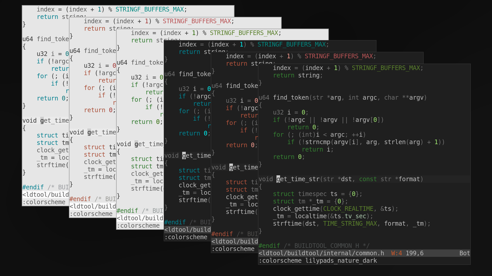
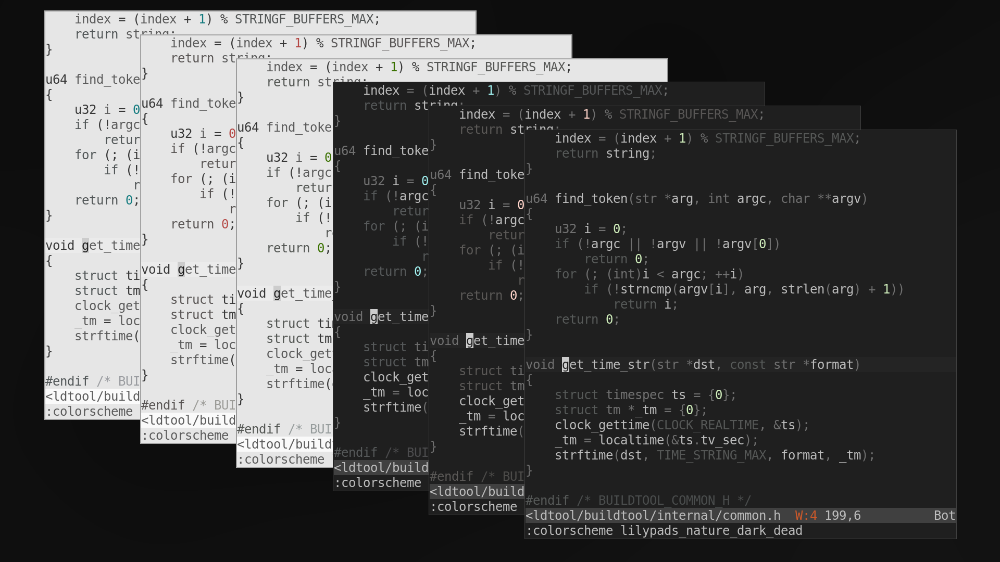

# Lilypads.Nvim

**a neovim colorscheme for minimal visual noise written in lua, with a few variants.**










## Variants
- lilypads_nature: shades of nature greens, from moss, to dry, to radioactive
    - dark
    - dark_dead
    - light
    - light_dead
- lilypads_cherry: shades of pink/peach
    - dark
    - dark_dead
    - light
    - light_dead
- lilypads_oceans: shades of blue/teal
    - dark
    - dark_dead
    - light
    - light_dead

## Install
- as of v2.0, the themes do not, out of the box, support any package managers,
but you can clone the repository into your config directory:
```bash
git clone --depth=1 https://github.com/awertnex/lilypads.nvim.git
mv lilypads.nvim ~/.config/nvim/pack/.../start/ # usually named "~/.config/nvim/pack/nvim/start/"
```
restart neovim and the colorschemes should appear in the `:colorscheme` list

>**NOTES:**
>- the theme is in early stages, right now I'm just highlighting the major groups
